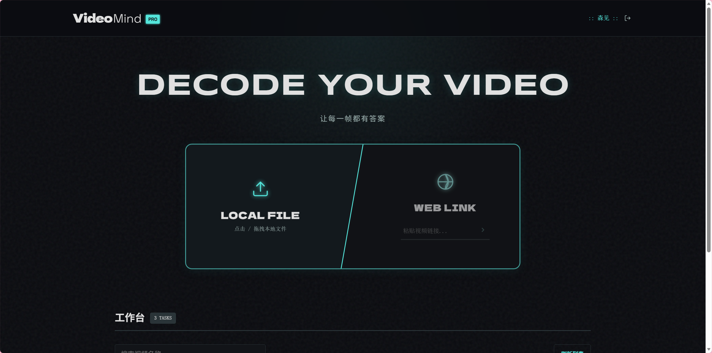
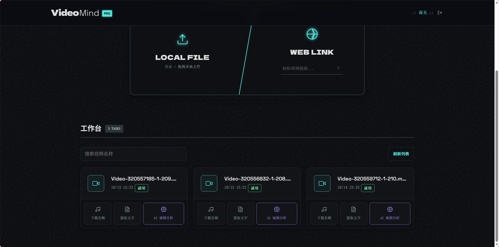
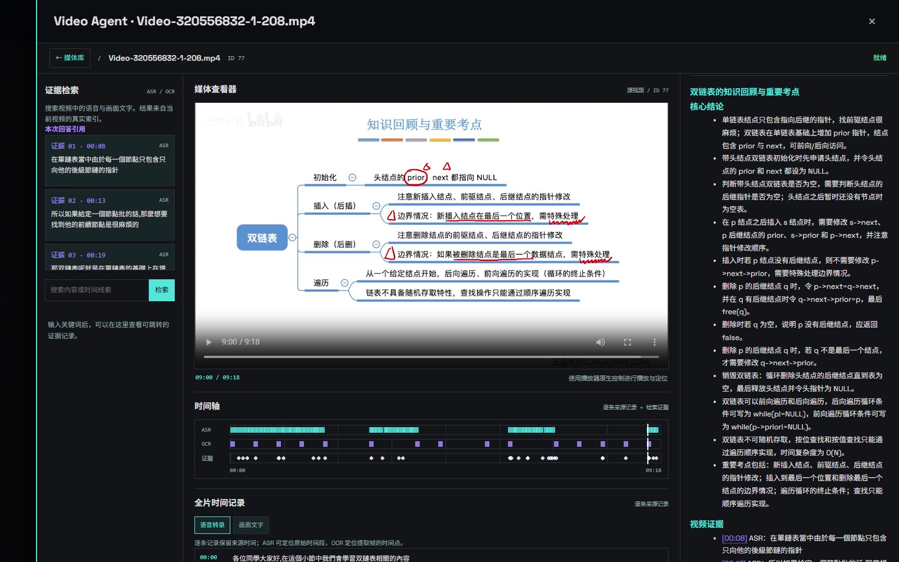
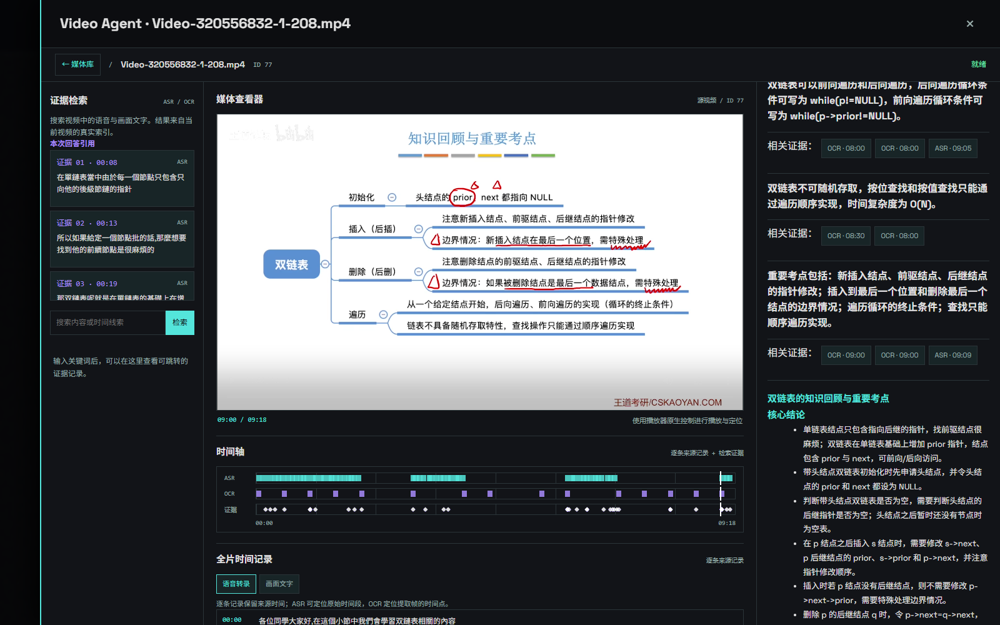
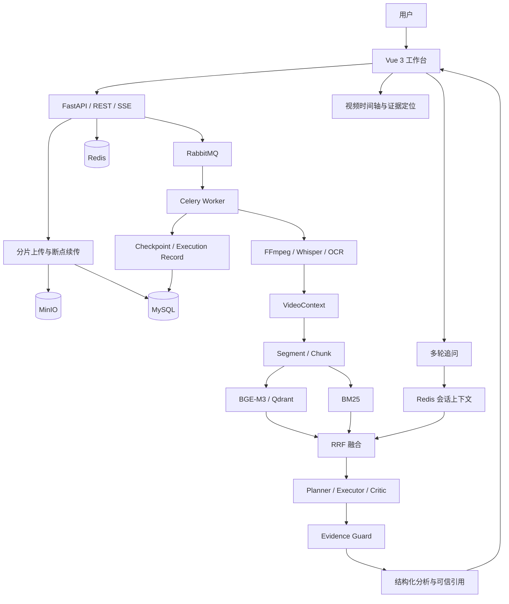

<div align="center">

# VideoMind

**DECODE YOUR VIDEO · 让每一帧都有答案**

面向长视频理解与深度分析的 **Video Agent 平台**

从视频上传、多模态解析到 Agent 自主分析与证据核验，让视频内容真正变得可检索、可理解、可追溯。

<p>
  
  
  
  
  
  <a href="LICENSE"></a>
</p>

</div>

---

## 🎬 项目介绍

**VideoMind** 是一个面向长视频内容理解与深度分析场景构建的智能 Video Agent 平台。

传统视频平台大多解决了视频的上传、存储与播放问题，但对于课程录像、技术讲解、会议记录等信息密集型长视频，用户仍然面临三个核心问题：

- **内容跨度大，关键信息分散。** 重要知识点可能分布在不同时间段，也可能同时存在于语音、板书和演示画面中，依靠人工拖动进度条查找效率低下。
- **处理链路复杂，执行耗时长。** 视频上传、音频转录、画面识别、向量索引及模型推理涉及多个耗时阶段，需要可靠的异步任务机制和故障恢复能力。
- **AI 结论难以追溯。** 普通视频总结往往只能给出一段自然语言回答，用户难以确定结论来自视频的哪个片段，也无法方便地核对原始内容。

针对这些问题，VideoMind 构建了一条完整的视频智能处理链路：

**稳健上传 → 异步多模态解析 → 时序上下文构建 → Hybrid RAG → Agent 规划与执行 → 可信证据核验 → 多轮追问。**

系统通过 FFmpeg、Whisper ASR 与 OCR 提取视频中的语音和画面文字，将其统一组织为携带时间戳、来源身份与版本信息的 `VideoContext`。

用户提出分析目标后，系统利用 Hybrid RAG 检索相关视频证据，由 Planner 制定分析计划、Executor 执行任务、Critic 检查结果，再通过应用层 Evidence Guard 对引用来源进行确定性校验。

最终，VideoMind 不仅能够生成结构化的视频分析结果，还能够将结论关联到真实的视频时间位置，帮助用户直接返回原片核查，并围绕同一视频继续追问。

**VideoMind 的核心目标不是简单地“让 AI 总结视频”，而是让 AI 能够基于视频证据完成可控、可恢复、可追溯的分析任务。**

---

## ✨ 项目预览

以下图片来自 VideoMind 的真实业务运行。

### 视频上传与媒体管理

<p align="center"></p>

### 视频工作台

<p align="center"></p>

### Video Agent 智能分析

<p align="center"></p>

### 多模态证据与视频定位

<p align="center"></p>


VideoMind 将视频播放器、ASR/OCR 记录、时序时间轴与 Agent 分析结果整合到统一工作区中。

用户可以查看分析结论对应的语音或画面证据，并通过时间戳定位到原视频片段，完成从 **AI 回答 → 可信引用 → 原始证据 → 视频时间点** 的交互闭环。

---

## 🚀 核心功能

### 1. 稳健上传与异步任务处理

> 解决大文件传输不稳定、长任务阻塞和重复执行带来的可靠性问题。

**分片上传与断点续传**

视频按照固定大小分片上传，通过 Redis 维护 UploadSession 和服务端已确认的分片状态，利用 MinIO 存储视频对象。

当网络中断或上传被取消时，客户端可以查询当前上传进度，跳过已经完成的分片并继续上传，避免重新传输整个视频。

WEB LINK 支持无需认证的公开 HTTPS MP4 直链，保留地址安全校验、重定向、下载体积和超时边界。

**上传幂等与并发控制**

结合上传会话身份、媒体归属校验、Merge Lock、顺序流式合并和 Completion Receipt，处理并发合并、重复完成请求及异常恢复等问题。

上传合并过程中流式计算 SHA-256，作为视频文件的内容指纹；视频预处理缓存使用 SHA-256 + Pipeline Contract 确定复用身份。分析任务则使用独立的 TaskKey 做幂等协调。直接上传和 URL 导入同样持久化真实视频字节的 SHA-256。

当前没有上传前计算哈希的秒传功能。Worker 仍先下载视频并计算 SHA-256，验证来源与版本后复用 VideoContext；这不代表全局复用所有 Chunk、Embedding 或 Agent 最终结果。历史 MD5 记录保持可读，不能当作 SHA-256 使用；需要新指纹时根据真实视频字节重算，已有有效内容缓存无需重建。

**RabbitMQ + Celery 异步解耦**

将耗时的视频解析与 Agent 分析从 HTTP 请求主链路中剥离。

API 负责请求准入和任务提交，Worker 在后台执行真正的业务流程，前端通过 SSE 获取执行状态。

**租约、Checkpoint 与故障恢复**

使用 Redis 任务租约协调并发执行，通过持久化 Checkpoint 记录已完成阶段。

Worker 发生异常或任务中断后，可以根据已保存的执行状态恢复，减少重复计算和重复调用模型的成本。

**Redis + Lua 限流**

使用用户级与全局级 Token Bucket，通过 Redis Lua 脚本原子完成令牌补充、额度检查和扣减，保护高成本 AI 请求入口。

---

### 2. 时序多模态 VideoContext

> 将语音、画面文字和时间信息融合为统一的视频证据表示。

VideoMind 采用多模态解析链路：

- **FFmpeg**：完成音频切分与关键帧提取。
- **Whisper ASR**：识别视频语音并保留对应时间区间。
- **Tesseract OCR**：识别板书、PPT 和其他画面文字。
- **VideoContext**：将不同模态的观察结果组织为统一的时序上下文。

系统以 60 秒 Segment 组织基础时序证据，并通过带重叠窗口的 Chunk 组织长上下文检索单元。

每条来源记录保留必要的时间戳、来源身份与版本信息，为后续检索、模型分析及证据校验提供统一依据。

区别于将完整转录文本直接输入模型，VideoMind 可以根据用户问题检索具体时间范围内的语音与画面文字，并将分析结果关联回原视频。

---

### 3. Hybrid RAG 混合检索

> 结合语义理解和关键词匹配，提高长视频中相关证据的检索能力。

VideoMind 使用 Dense 与 Sparse 双路检索：

- **Dense Retrieval**：通过 BGE-M3 生成文本向量，使用 Qdrant 进行语义召回。
- **Sparse Retrieval**：通过 BM25 进行关键词匹配，补充专业术语、具体名称和精确表述的检索能力。
- **RRF Fusion**：融合两路候选结果，形成统一的相关证据集合。
- **候选去重与重排序**：对候选来源进行整理，并按照现有检索策略控制输入规模；可按配置接入 Reranker。

检索不仅关注文本相似度，还需要保持媒体身份、来源版本与时间范围的一致性。

Agent 获得的是与用户问题相关的视频证据，而不是无边界的历史对话或其他视频内容。

---

### 4. Planner → Executor → Critic Agent 闭环

> 让 Agent 从一次性内容生成，升级为具备任务规划、执行、检查和有限修订能力的分析流程。

VideoMind 实现了自研 AgentLoop，围绕用户分析目标形成三个主要角色：

**Planner — 任务规划**

理解用户目标，将复杂分析请求拆解为具有明确目的的子任务，组织后续执行流程。

**Executor — 任务执行**

结合检索到的视频证据执行分析，并生成结构化结论、相关内容与候选引用。

Executor 可以根据受控工具协议提出工具调用请求，获取进一步的视频信息。

**Critic — 结果校验**

检查分析结果是否覆盖用户目标、内容是否完整，以及结论与引用证据是否具有合理的语义支持。

当结果存在明显问题时，Agent 可以根据反馈补充证据、修订计划或重新生成内容。

**Harness — 确定性执行边界**

模型负责提出行动和生成内容，但最终能否执行工具、能够访问哪些数据、是否满足调用预算以及引用是否合法，均由应用层规则控制。

系统通过 ToolRegistry、ToolPolicy、结构化输出校验、执行预算、Checkpoint 和 Execution Record 对 Agent 行为进行约束与记录。

这一设计将模型的不确定性与业务系统的确定性控制分离，使 Agent 执行过程更加可控、可追踪。

---

### 5. Evidence Guard 与可追溯视频引用

> 不仅生成答案，还要让用户能够找到答案在视频中的依据。

VideoMind 将模型生成的候选证据与原始 `VideoContext` 中的真实来源进行校验。

验证内容包括：

- 来源身份是否合法。
- 来源版本是否一致。
- 引用原文是否对应真实观察记录。
- 引用时间是否对应来源记录的时间范围。
- 最终展示的 Citation 是否具有合法来源绑定。

通过校验的引用可以关联到结构化结论，并在前端展示为可交互的证据入口。

用户点击对应引用，即可定位到视频中的相关时间位置，并结合语音或画面文字核对分析内容。

**Critic 与 Evidence Guard 承担不同职责：**

Critic 负责模型层面的语义质量判断，Evidence Guard 负责应用层的来源与引用合法性校验。

来源合法不等于自然语言结论必然正确，但能够有效避免将不存在或不匹配的视频来源直接展示为可信证据。

---

### 6. 多轮追问与上下文管理

> 在连续对话中保持用户意图，同时确保回答依然建立在当前视频证据之上。

VideoMind 基于 Redis 实现面向视频分析的多轮会话机制。

通过近期完整问答、滚动摘要和会话身份维护上下文，使系统能够处理：

- 对前一次回答的补充提问。
- 对某个知识点的进一步解释。
- “它”“上一点”“刚才提到的内容”等指代问题。
- 同一视频中的连续知识探索。

对于需要上下文消解的问题，可以结合历史会话生成独立检索查询，再使用当前视频的真实证据进行回答。

同时按照用户、媒体、分析目标、会话与来源版本进行隔离，避免不同用户或不同视频之间的上下文污染。

历史回答用于理解当前问题，而不会自动成为新的可信视频来源。

---

## 🧩 系统架构



VideoMind 使用 Vue 3 与 FastAPI 构建前后端交互层，通过 RabbitMQ/Celery 处理耗时任务。

MySQL 负责持久化业务数据，Redis 管理运行态、限流、租约与对话上下文，MinIO 保存视频对象，Qdrant 提供向量检索能力。

Agent 分析过程围绕统一的时序证据展开，并通过 Checkpoint、执行记录和 Evidence Guard 实现状态恢复与来源校验。

---

## 🛠️ 技术栈

| 模块 | 技术选型 | 主要用途 |
|---|---|---|
| 前端 | Vue 3、Vite、JavaScript、CSS | 媒体工作台、分析结果、视频交互 |
| Web API | Python、FastAPI、Pydantic | 用户鉴权、上传、REST 与 SSE |
| 异步任务 | RabbitMQ、Celery | 任务分发、异步执行与恢复 |
| 状态管理 | Redis、Lua | Token Bucket、任务租约与会话 |
| 关系数据库 | MySQL、SQLAlchemy、Alembic | 业务数据、持久化与数据库迁移 |
| 对象存储 | MinIO | 视频文件及相关对象 |
| 多模态解析 | FFmpeg、Whisper、Tesseract | 音频、ASR、关键帧与 OCR |
| 向量检索 | BGE-M3、Qdrant | Dense Retrieval |
| 混合检索 | BM25、RRF | Sparse Retrieval 与结果融合 |
| Agent | Planner、Executor、Critic、Harness | 规划、执行、校验与工具管理 |
| 部署与开发 | Docker Compose、PowerShell | 本地服务编排与运行管理 |

---

## 💻 如何本地运行

### 环境要求

- Python 3.12+
- Node.js 22.12+
- Docker Desktop / Docker Compose
- FFmpeg / ffprobe
- Tesseract OCR
- Whisper 运行依赖
- 可用的聊天模型与 Embedding Provider 配置

项目完整运行依赖 MySQL、Redis、RabbitMQ、MinIO、Qdrant 和 Celery Worker。

### 1. 环境配置

克隆项目：

```bash
git clone https://github.com/Morimi-Kazuha/VideoMind.git
cd VideoMind
```

根据项目中的 `.env.example` 与完整启动文档配置数据库、对象存储、消息队列和 AI Provider。

真实密钥及密码应保存在本地私有配置中，不要提交到 GitHub。

### 2. 启动服务

对于已完成配置的 Windows 开发环境，可以使用项目提供的 PowerShell 脚本管理本地服务：

```powershell
.\scripts\local-product.ps1 Status
.\scripts\local-product.ps1 Start
```

启动后根据终端输出访问前端地址。

新环境需要先完成依赖安装和数据库初始化或迁移，并按启动指南从 `scripts/local-product.settings.example.json` 创建本地私有 settings 文件。

具体说明见：

[完整启动指南](docs/QUICK_START.md)

### 3. 前端开发

```bash
cd client
npm ci
npm run dev
```

### 4. 测试

后端：

```bash
python -m pytest -q
```

前端：

```bash
cd client
npm test
npm run build
```

---

## 📌 项目说明

VideoMind 主要围绕真实视频内容展开分析。

系统能够对视频中的语音和画面文字建立时序索引，使用 Hybrid RAG 召回证据，并由 Agent 进行结构化分析。

对于需要视频依据的结论，系统通过来源校验和时间戳引用建立与原片的关联。

实际分析耗时和模型资源消耗会受到视频内容密度、检索规模、模型响应以及 Agent 修订次数等因素影响。

相关设计与工程实现可以参考：

- [系统架构](docs/ARCHITECTURE.md)
- [RAG 检索](docs/RETRIEVAL.md)
- [多轮上下文](docs/CONVERSATION_MEMORY.md)
- [异步任务与可靠性](docs/VIDEOMIND_R6_ASYNC_RELIABILITY_REPORT.md)

---

## 📄 License

本项目采用 [MIT License](LICENSE) 开源。

第三方组件及资源的相关版权信息见仓库中的 NOTICE 和许可文件。
